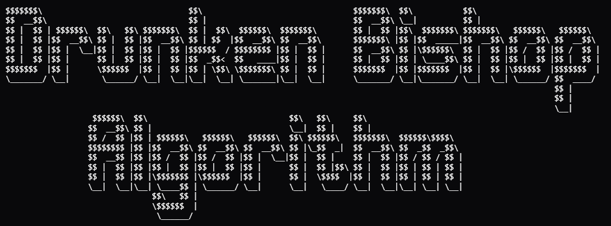

# ASCII Art - The Drunken Bishop Algorithm


[Lien vers l'exercice CodingGame](https://www.codingame.com/training/easy/ascii-art-the-drunken-bishop-algorithm)



---

## 1. Introduction

Ce puzzle coding game traite de la génération du **SSH Randomart**, aussi appelé *Drunken Bishop Algorithm*. C'est l'algorithme utilisé par [OpenSSH](https://fr.wikipedia.org/wiki/OpenSSH) pour produire des petits dessins ASCII afin de rendre une empreinte hexadécimale visuellement reconnaissable pour un humain.

Le but est que a partir d'une empreinte hexadécimale de 32 octets, on déplace un "évêque" sur une grille 17×9, en partant du centre (8 ; 4) notée `S`. Chaque octet de l'empreinte code 4 déplacements diagonaux grâce à ses paires de bits. Une fois les 128 déplacements effectués, chaque case de la grille affiche un symbole selon le nombre de fois que l'évêque l'a visitée, et la case finale est marquée `E`.

---

## 2. Algorithme de résolution

Afin de résoudre ce problème, on suivra l'algorithme suivant :

1. Initialiser une grille 17×9 remplie de zéros, et placer le curseur au centre en (8, 4).
2. Découper l'empreinte hexadécimale octet par octet .
3. **Pour chaque octet** :
   - Convertir l'octet hexadécimal en entier.
   - **Pour chaque paire de bits** (de 0 à 3, en partant du poids faible) :
     - Extraire la paire par décalage et masque.
     - **Selon la valeur de la paire** : déterminer la direction diagonale qui correspond a la valeur (haut-gauche, haut-droite, bas-gauche ou bas-droite).
     - Calculer la position suivante.
     - **Si** la nouvelle position sort des bornes horizontales on annule le déplacement horizontal.
     - **Si** la nouvelle position sort des bornes verticales alors on annule le déplacement vertical.
     - Mettre à jour la position et incrémenter le compteur de la case atteinte.
4. sauvegarder  la position finale.
5. Afficher la grille : **pour chaque case**, afficher le point de départ, d'arrivée, ou le symbole correspondant au compteur.


---


## 3. Code commenté

[*Voir le fichier bishop.py*](./bishop.py)

```python
fingerprint = input()

# Symboles utilisés pour représenter le nombre de passages sur une case
SYMBOLES = [' ', '.', 'o', '+', '=', '*', 'B', 'O', 'X', '@', '%', '&', '#', '/', '^']
LARGEUR, HAUTEUR = 17, 9

# Grille qui va compter le nombre de passages sur chaque case
grille = [[0] * LARGEUR for i in range(HAUTEUR)]

# Position de départ du curseur
x, y = 8, 4
depart = (x, y)

# On sépare l'empreinte en octets
liste_octets = fingerprint.split(':')

for octet in liste_octets:
    # On convertit l'octet hexadécimal en entier
    valeur = int(octet, 16)
    for n in range(4):
        # On extrait la n-ième paire de bits (de droite à gauche)
        paire = (valeur >> (n * 2)) & 0b11

        # On associe chaque paire à une direction diagonale
        if paire == 0b00:
            dx, dy = -1, -1  # haut-gauche
        elif paire == 0b01:
            dx, dy = 1, -1   # haut-droite
        elif paire == 0b10:
            dx, dy = -1, 1   # bas-gauche
        else:
            dx, dy = 1, 1    # bas-droite

        nx = x + dx
        ny = y + dy

        # Si le curseur sort de la grille, on annule le déplacement sur l'axe concerné
        if nx < 0 or nx >= LARGEUR:
            nx = x
        if ny < 0 or ny >= HAUTEUR:
            ny = y

        x, y = nx, ny
        # On incrémente le compteur de la case visitée
        grille[y][x] += 1

# On mémorise la position finale
arrivee = (x, y)

print("+---[CODINGAME]---+")
for i in range(HAUTEUR):
    ligne = "|"
    for j in range(LARGEUR):
        # On place S au départ, E à l'arrivée, sinon le symbole correspondant
        if (j, i) == depart:
            ligne += "S"
        elif (j, i) == arrivee:
            ligne += "E"
        else:
            # Le modulo évite de dépasser la taille de la liste
            ligne += SYMBOLES[grille[i][j] % len(SYMBOLES)]
    print(ligne + "|")
print("+-----------------+")
```

---

## 4. Résultats

Pour l'empreinte `16:27:ac:a5:76:28:2d:36:63:1b:56:4d:eb:df:a6:48` :

```
+---[CODINGAME]---+
|        .        |
|       + .       |
|      . B .      |
|     o S +       |
|    . * o        |
|   o B + .       |
|  . O o .        |
|   .=E           |
|    ..           |
+-----------------+
```

Les cases centrales ont plus de passages (symboles denses comme `B`, `O`), ce qui est logique car l'évêque part du centre et à plus de chances d'y rester.

---

## 5. Solution alternative

[Voir la solution de *NiXerasse* sur CodingGame](https://www.codingame.com/training/easy/ascii-art-the-drunken-bishop-algorithm/solution?id=31142030)

```python
bits = f'{int(input().replace(":", ""), 16):0128b}'
f = [[0] * 17 for _ in range(9)]

x, y = 8, 4
for i in range(0, 128, 8):
    byte = bits[i:i+8][::-1]
    for a, b in zip(byte[::2], byte[1::2]):
        dx, dy = [(-1, -1), (-1, 1), (1, -1), (1, 1)][int(a + b, 2)]
        x += dx * (0 <= x + dx < 17)
        y += dy * (0 <= y + dy < 9)
        f[y][x] += 1

for py in range(9):
    for px in range(17):
        f[py][px] = ' .o+=*BOX@%&#/^'[f[py][px] % 15]
f[4][8], f[y][x] = 'SE'

print('+---[CODINGAME]---+')
for r in f:
    print('|' + ''.join(r) + '|')
print('+-----------------+')
```

Cette solution à  un peu près le même algorithme que le mien, mais la forme est différente.

La première différence majeure concerne la conversion de l'empreinte. Là où je traite les octets un par un dans une boucle, NiXerasse convertit toute l'empreinte en une seule chaîne de 128 bits dès le départ avec `f'{int(..., 16):0128b}'`. 

La deuxième différence est la gestion de l'ordre LSB-first. Dans mon code, je l'obtiens grâce au décalage `>> (n * 2)`. Ici, l'octet est simplement inversé avec `[::-1]` avant d'en extraire les paires.

La troisième différence est la gestion des bords. Au lieu d'un `if`, le déplacement est multiplié par le résultat d'une comparaison booléenne : `dx * (0 <= x + dx < 17)`. Donc si la nouvelle position sort de la grille, le déplacement est annulé par la multiplication par `0`. 


---

## 6. Bilan

Ce projet m'a permis de manipuler les bits en Python notamment les décalages `>>` que je n'avais jamais utilisés avant. J'ai aussi vu que l'ordre LSB-first est une convention du protocole SSH.

En regardant la solution de NiXerasse, j'ai vu une autre facon de gérer les bords en faisant la multiplication booléenne au lieu des `if`.

---
