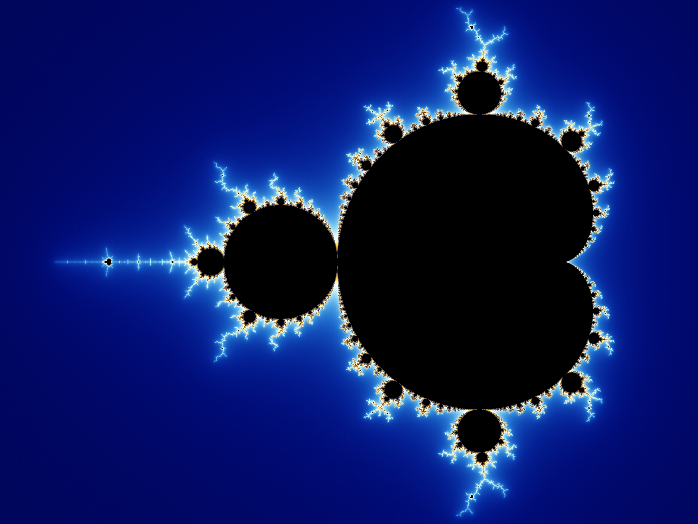
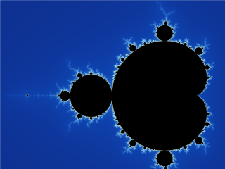
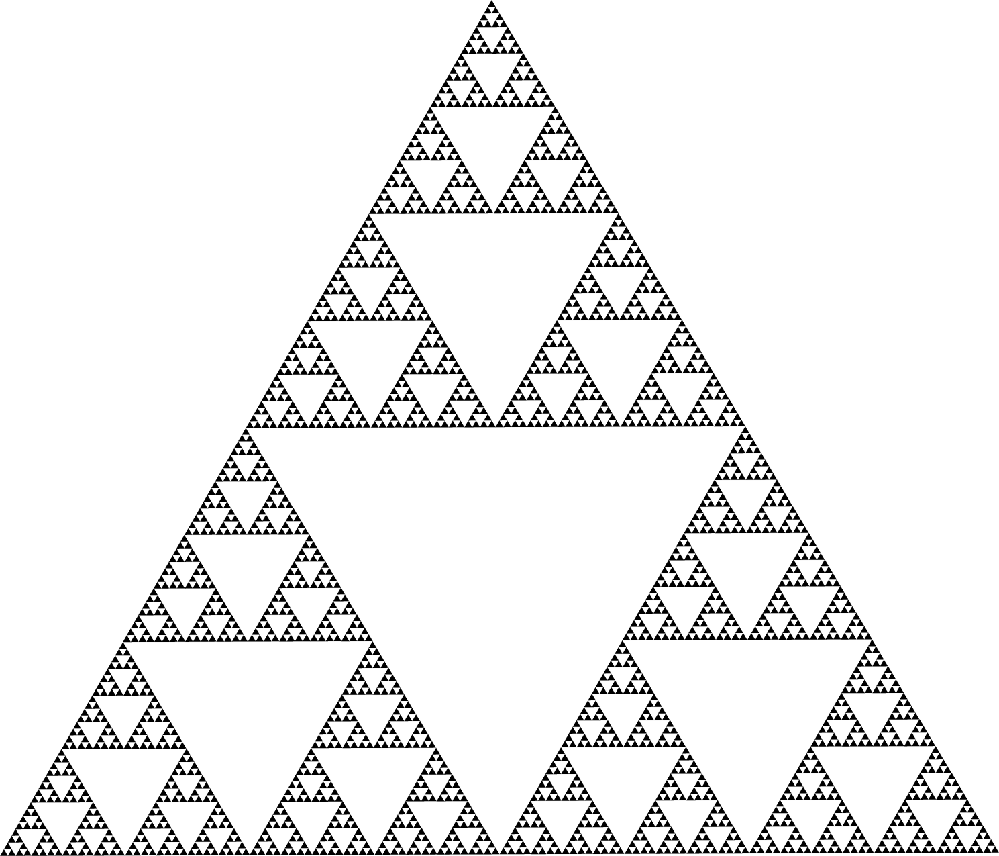
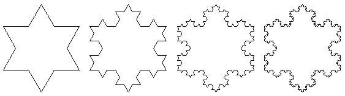

# Les Fractales - Mathématiques de l'Infini

## 1. Introduction

Les [fractales](https://fr.wikipedia.org/wiki/Fractale) sont le sujet que j'avais choisi pour mon Grand Oral de terminale. On les retrouvent partout dans la nature : flocons de neige, côtes rocheuses, arbres, vaisseaux sanguins.

> *"Bottomless wonders spring from simple rules, which are repeated without end."*
> - Benoît Mandelbrot, 1982



---

## 2. Qu'est-ce qu'une fractale ?

Une fractale c'est une structure géométrique qui présente la propriété d'**auto-similarité** : elle se répète à l'identique (ou presque) a toutes les échelles d'observation.

### Propriétés fondamentales

- **Auto-similarité** : chaque partie ressemble au tout
- **Dimension non entiere** : une fractale peut avoir une dimension de 1.58, par exemple
- **Complexité infinie** : on peut zoomer indéfiniment sans perdre le détail
- **Construction itérative** : générées par la répétition d'une règle simple

---

## 3. L'ensemble de Mandelbrot

C'est la fractale la plus célèbre. Elle est définie dans le plan complexe par la suite :

$$z_{n+1} = z_n^2 + c$$

avec $z_0 = 0$ et $c \in \mathbb{C}$.

Un point $c$ appartient à l'ensemble de Mandelbrot si et seulement si la suite $(z_n)$ **reste bornée** :

$$\exists M > 0, \quad \forall n \in \mathbb{N}, \quad |z_n| \leq M$$

Si $|z_n| > 2$ pour un certain $n$, la suite diverge et $c$ n'appartient pas à l'ensemble.



---

## 4. Autres fractales célèbres

### Le triangle de Sierpiński

Il est obtenu en retirant récursivement le triangle central de chaque triangle :

| Itération | Nombre de triangles |
|-----------|---------------------|
| 0         | 1                   |
| 1         | 3                   |
| 2         | 9                   |
| $n$       | $3^n$               |



### Le flocon de Koch

il est Construit à partir d'un triangle équilatéral en remplaçant à chaque itération le tiers central de chaque segment par un triangle équilatéral.

**Étapes de construction :**

1. Partir d'un segment de longueur $L$
2. Diviser en 3 parties égales
3. Remplacer la partie centrale par deux côtés d'un triangle équilatéral
4. Répéter à l'infini sur chaque segment




---

## 5. Implémentation - Flocon de Koch

Le code suivant calcule le périmètre du flocon de Koch après un nombre d'itérations
donné. 


### En C


```c
#include <stdio.h>

int main() {
    int nb_segments = 3;
    double longueur = 1.0;

    printf("Iteration | Perimetre\n");
    printf("----------|----------\n");

    for (int n = 0; n <= 6; n++) {
        double perimetre = nb_segments * longueur;
        printf("    %d     | %.6f\n", n, perimetre);

    
        nb_segments = nb_segments * 4;
        longueur = longueur / 3.0;
    }

    return 0;
}
```

### En Python

```python
nb_segments = 3
longueur = 1.0

print("Iteration | Perimetre")
print("----------|----------")

for n in range(7):
    perimetre = nb_segments * longueur
    print(f"    {n}     | {perimetre:.6f}")

    # a chaque iteration : 4x plus de segments, chacun 3x plus court
    nb_segments = nb_segments * 4
    longueur = longueur / 3
```

**Sortie des deux programmes :**

| Itération | Périmètre  |
|-----------|------------|
| 0         | 3.000000   |
| 1         | 4.000000   |
| 2         | 5.333333   |
| 3         | 7.111111   |
| 4         | 9.481481   |
| 5         | 12.641975  |
| 6         | 16.855967  |

Le périmètre tend vers l'infini à mesure que les itérations augmentent, alors
que l'aire reste finie.

---