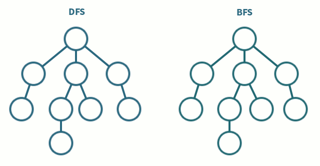

# The Other Side

[Lien vers l'exercice CodingGame](https://www.codingame.com/training/easy/the-other-side)

[*maze solving.gif*](https://commons.wikimedia.org/wiki/File:Picture_maze_solving.gif)

---

## 1. Introduction

Ce projet porte sur le puzzle *The Other Side*, de CodingGame. Le problème est le suivant : on dispose d'une grille de `h` lignes et `w` colonnes, composée uniquement de caractères `+` et `#`. L'objectif est de compter combien de cellules `+` situées dans la colonne la plus à gauche permettent d'atteindre la colonne la plus à droite, en se déplaçant de case en case (horizontalement ou verticalement), et en ne passant que par des cellules `+`.


---

## 2. Algorithme de résolution


Le BFS (parcours en largeur) explore une grille case par case en s'éloignant
progressivement du point de départ, comme une vague qui se propage. On va l'utiliser
ici car il est simple à implémenter et permet de ne pas tourner en rond
grâce à la grille `visite`.

Afin de résoudre ce problème, on suivra l'algorithme suivant :

1. Lire la grille de `h` lignes et `w` colonnes.
2. Parcourir la colonne de gauche ligne par ligne :
   1. Si la case vaut `+`, lancer un BFS depuis cette case.
   2. Sinon, passer à la ligne suivante.
3. Pour chaque BFS lancé :
   1. Initialiser une grille `visite` vierge et y marquer le point de départ.
   2. Explorer les voisins (haut, bas, gauche, droite) en n'ajoutant à la file que les cases `+` non visitées.
   3. Si la dernière colonne est atteinte, incrémenter le compteur et arrêter.
4. Afficher le compteur final.


---

## 3. Code commenté

### 3.1 Version itérative (BFS avec liste + index)

[*Voirle fichier otherside_iter.py*](./otherside_iter.py)

```python
import sys
h = int(input())
w = int(input())

# Lecture brute : chaque ligne est une chaîne "+ # + +", les cases utiles sont aux indices pairs
grille = []
for i in range(h):
    ligne = input()
    grille.append(ligne)

count = 0
directions = [(-1, 0), (1, 0), (0, -1), (0, 1)]  # haut, bas, gauche, droite

for i in range(h):
    if grille[i][0] == '+':  # on ne part que des '+' de la colonne gauche

        file = [(i, 0)]

        # Grille de cases visitées, réinitialisée à chaque nouveau point de départ
        visite = []
        for r in range(h):
            visite.append([False] * w)
        visite[i][0] = True

        trouve = False
        j = 0  # index de lecture dans la file  évite un pop(0) coûteux

        while j < len(file) and not trouve:
            ligne, col = file[j]
            j += 1

            if col == w - 1:  # dernière colonne atteinte : chemin trouvé
                trouve = True
            else:
                for dl, dc in directions:
                    nl, nc = ligne + dl, col + dc
                    if 0 <= nl < h and 0 <= nc < w:
                        # nc*2 car la colonne logique nc est à l'indice nc*2 dans la chaîne brute
                        if grille[nl][nc*2] == '+' and not visite[nl][nc]:
                            visite[nl][nc] = True
                            file.append((nl, nc))

        if trouve:
            count += 1

print(count)
```


---

### 3.2 Version récursive (DFS)


[*Voir le fichier otherside_recur.py*](./otherside_recur.py)

```python
h = int(input())
w = int(input())

# Lecture brute : même principe que la version itérative
grille = []
for i in range(h):
    ligne = input()
    grille.append(ligne)

directions = [(-1, 0), (1, 0), (0, -1), (0, 1)]  # haut, bas, gauche, droite

def dfs(ligne, col, visite):
    if col == w - 1:  # cas de base : on a atteint la dernière colonne
        return True
    for dl, dc in directions:
        nl, nc = ligne + dl, col + dc
        if 0 <= nl < h and 0 <= nc < w:
            # nc*2 car la colonne logique nc est à l'indice nc*2 dans la chaîne brute
            if grille[nl][nc*2] == '+' and not visite[nl][nc]:
                visite[nl][nc] = True
                if dfs(nl, nc, visite):  # on remonte dès qu'un chemin est trouvé
                    return True
    return False  # aucun voisin n'a mené à la droite

count = 0

for i in range(h):
    if grille[i][0] == '+':  # on ne part que des '+' de la colonne gauche
        # Grille de cases visitées, réinitialisée à chaque nouveau point de départ
        visite = []
        for r in range(h):
            visite.append([False] * w)
        visite[i][0] = True
        if dfs(i, 0, visite):
            count += 1

print(count)
```

La version récursive est directement copiée de la version itérative. Au lieu d'ajouter les voisins dans une file et d'avancer avec un index , on appelle la fonction elle-même. On passe ainsi d'un BFS à un DFS sans trop changer l'algo.

```python
def dfs(ligne, col, visite):
    if col == w - 1:              # cas de base : on a atteint la droite
        return True
    for dl, dc in directions:
        nl, nc = ligne + dl, col + dc
        if 0 <= nl < h and 0 <= nc < w:
            if grille[nl][nc*2] == '+' and not visite[nl][nc]:
                visite[nl][nc] = True
                if dfs(nl, nc, visite):   # si un chemin est trouvé plus loin...
                    return True           # ...on remonte immédiatement
    return False                          # aucun voisin n'a mené à la droite
```

La différence clé avec le BFS c'est que le DFS va dans la première branche venue avant d'essayer les autres. 

```python
for i in range(h):
    if grille[i][0] == '+':
        visite = []
        for r in range(h):
            visite.append([False] * w)
        visite[i][0] = True
        if dfs(i, 0, visite):
            count += 1

print(count)
```

La boucle principale est identique à la version itérative : on repart d'une grille `visite` vierge pour chaque point de départ.


---

## 4. Résultats


Pour la grille suivante (h=4, w=4) :

```
+ # + +
+ + + #
# # + +
+ # # #
```

Le programme affiche `2` : les `+` des lignes 0 et 1 atteignent la colonne droite, celui de la ligne 3 est isolé.


---

## 5. Solution alternative - CarlWash

[Voir la solution de *CarlWash* sur CodingGame](https://www.codingame.com/training/easy/the-other-side/solution?id=33350813)

```python
h, w = int(input()), int(input())
grid = {complex(x, y) for y in range(h) for x, c in enumerate(input().split()) if c == '+'}

seen = set()
def dfs(p):
    if p in seen or p not in grid: return
    seen.add(p)
    for i in range(4):
        dfs(p + 1j**i)

for y in range(h): dfs(complex(w-1, y))
print(sum(complex(0, y) in seen for y in range(h)))
```

Ici même DFS que ma version récursive, mais trois différences notables.

La grille est stockée comme un ensemble de nombres complexes : chaque `+` devient `complex(x, y)`. Tester si une case est valide se fait alors avec `p in grid` en O(1).

Les directions sont faites avec `1j**i`, car multiplier par `j` revient à une rotation de 90 degrès (pas le genre de truc qu'on pense tout de suite à faire).

La différence la plus intéressante algorithmiquement, c'est le sens du parcours, ici ilpart de la colonne droite et fait **un seul DFS** pour marquer tout ce qui est atteignable dans `seen`. Il faut juste ensuite compter les cases de la colonne gauche présentes dans `seen`. 

---

## 6. Bilan

Cet exercice était une bonne introduction aux algorithmes de parcours de graphe. Le BFS et le DFS sur grille, c'est quelque chose qu'on avait deja aborder en cours de terminal.

Je n'ai pas spécialment appris de nouvelles choses en terme de python pur. Ce qui m'a le plus appris, c'est la solution de CarlWash avec l'idée de partir de la droite plutôt que de la gauche, et l'utilisation de nomnbre complexes.

---