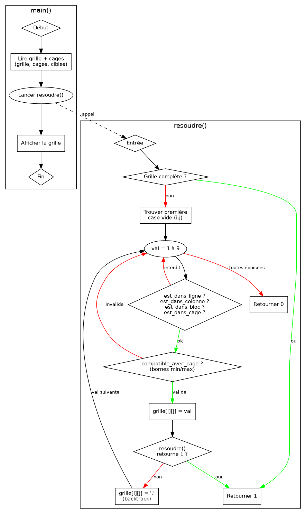

#+HTML_HEAD: <link rel="stylesheet" href="../css/org.css">
#+HTML_HEAD_EXTRA: 
#+OPTIONS: toc:t num:t html-style:nil html-scripts:nil H:4

#+TITLE: Rapport - Killer Sudoku
#+AUTHOR: ALEXANDRE Maé - Prep'ISIMA 1
#+DATE: 5 Mars 2026
#+OPTIONS: toc:1
#+LANGUAGE: fr

- [[https://www.codingame.com/training/medium/killer-sudoku-solver][Lien vers le puzzle sur CodingGame]]

#+ATTR_HTML: :width 50%
[[../images/sudoku.png]]
-----

* Introduction

Le Killer Sudoku est une variante du Sudoku classique. La différence principale,
c'est qu'il y a des /cages/ qui sont ,des groupes de cases dont les valeurs doivent sommer
à une cible donnée, sans répéter de chiffre dans la cage.

Il y a quatres règles à respecter en même temps :

1. *Ligne* : chaque ligne contient les chiffres de 1 à 9 sans répétition.
2. *Colonne* : chaque colonne contient les chiffres de 1 à 9 sans répétition.
3. *Région* : chaque carré 3×3 contient les chiffres de 1 à 9 sans répétition.
4. *Cage* : les cases d'une même cage doivent sommer exactement à la valeur cible,
   sans répétition interne.

En entrée on a une grille 9×9 pas entièrement remplies, une grille d'identifiants de
cages (lettres =a=–=z= et =A=–=Z=), et les sommes cibles de chaque cage. En sortie
on doit afficher la grille complète et résolue.

Pour résoudre ce problème j'ai utilisé du backtracking.

-----

* Analyse du problème

En entrée, chaque ligne contient deux mots séparés par un espace : le premier
représente une ligne de la grille (=.= pour les cases vides, un chiffre pour les
cases déjà remplies), et le deuxième donne l'identifiant de cage pour chacune des
9 cases de cette ligne. La dixième et dernière ligne liste les sommes cibles sous
la forme =id=valeur=.

#+BEGIN_EXAMPLE
56..1..2. aabbccdde
..72..68. afghhiide
..2.87.15 jfggklmme
......3.9 jjgnklopp
.7....2.. qqgnooorr
9.634.8.. stuuvwwxx
2.9..8... stuuvvwyz
..41.2... sAuuByyyz
.8.4...3. CADDBEEFF
a=12 b=17 c=4 d=14 e=15 f=13 g=19 h=7 i=10 j=16 k=10 l=13 m=10 n=15 o=15 p=13 q=11 r=11 s=18 t=3 u=28 v=15 w=20 x=8 y=22 z=12 A=11 B=13 C=6 D=9 E=10 F=5
#+END_EXAMPLE

Une cage peut avoir n'importe quelle forme et aller sur plusieurs lignes.
Pour stocker les infos de chaque cage j'utilise deux tableaux de taille 256 indexés
directement par le code ASCII de la lettre, ce qui évite d'avoir une fonction de
conversion.

Le vrai problème avec ce puzzle c'est la performance car il y a énormément de
combinaisons possibles, et un backtracking qui teste tout bêtement va dépasser
le temps limite.L'idée c'est  de détecter des que l'on peut  qu'une branche ne peut
pas marcher, pour ne pas aller plus loin inutilement.

-----

* Méthode de résolution

Pour résoudre la grille j'utilise du backtracking récursif : on essaie des valeurs case par case, et si on se retrouve bloqué on revient en arrière pour tenter autre chose.
 Pour que ça reste suffisamment rapide, on essaie de détecter les mauvaises pistes le plus tôt possible afin de ne pas explorer des branches inutiles.
Les vérifications classiques du sudoku (ligne, colonne, bloc 3×3) sont faites avec des fonctions dédiées qui parcourent simplement la grille. 
Pour savoir si =val= est jouable en =(i, j)=, on appelle les quatre fonctions et on rejette la valeur dès que l'une d'elles retourne 1 :
#+BEGIN_EXAMPLE
si est_dans_ligne(grille, i, val)         // on rejette val
si est_dans_colonne(grille, j, val)       // on rejette val
si est_dans_bloc(grille, i, j, val)       // on rejette val
si est_dans_cage(grille, cages, lettre, val) // on rejette val
#+END_EXAMPLE
On ajoute une vérification supplémentaire via la fonction =compatible_avec_cage=. À chaque fois qu'on essaie une valeur =val= dans une cage, on recalcule la somme déjà posée et le nombre de cases qu'il reste à remplir.
 Si c'est la dernière case de la cage, la somme doit tomber exactement sur la cible. Sinon, on vérifie que ce qu'il reste à atteindre est encore possible avec les cases restantes, en encadrant la somme restante entre un minimum et un maximum :
#+BEGIN_EXAMPLE
somme_min = k*(k+1)/2
somme_max = k*(19-k)/2     avec k = cases_restantes
#+END_EXAMPLE
Si =somme_restante= sort de cet intervalle, on rejette la valeur immédiatement sans aller plus loin.

-----

* Algorithme

Le diagramme ci-dessous illustre le fonctionnement global du programme (gauche)
et le détail de la fonction récursive =resoudre()= (droite).

#+BEGIN_SRC dot :file ../images/backtracking.png :cmdline -Kdot -Tpng
digraph killer_sudoku {
  rankdir=TB
  bgcolor="white"
  node [fontname="Helvetica" fontsize=11 style=filled]
  edge [fontname="Helvetica" fontsize=10]

  debut    [label="Début" shape=ellipse fillcolor="#d5f5e3" color="#27ae60"]
  lire     [label="Lire grille + cages + cibles" shape=box fillcolor="#d6eaf8" color="#2980b9"]
  appel    [label="Appel resoudre()" shape=box fillcolor="#f5eef8" color="#8e44ad"]

  complete [label="Grille complète ?" shape=diamond fillcolor="#fef9e7" color="#f39c12"]
  cherche  [label="Trouver la première case vide (i, j)" shape=box fillcolor="#d6eaf8" color="#2980b9"]
  boucle   [label="Tester val = 1 à 9" shape=ellipse fillcolor="#f5eef8" color="#8e44ad"]

  verif    [label="Val valide ?\n(ligne, colonne, bloc 3×3, cage)" shape=diamond fillcolor="#fdedec" color="#e74c3c"]
  elagage  [label="Somme cage encore atteignable ?\n(bornes min/max)" shape=diamond fillcolor="#fef9e7" color="#f39c12"]

  placer   [label="grille[i][j] = val" shape=box fillcolor="#d5f5e3" color="#27ae60"]
  recurs   [label="Appel récursif resoudre() → succès ?" shape=diamond fillcolor="#f5eef8" color="#8e44ad"]
  backtrack [label="grille[i][j] = '.'  (backtrack)" shape=box fillcolor="#fdedec" color="#e74c3c"]
  retour0  [label="Retourner 0 (échec, on remonte)" shape=box fillcolor="#fdedec" color="#e74c3c"]
  retour1  [label="Retourner 1 (succès)" shape=box fillcolor="#d5f5e3" color="#27ae60"]

  afficher [label="Afficher la grille résolue" shape=box fillcolor="#d6eaf8" color="#2980b9"]
  fin      [label="Fin" shape=ellipse fillcolor="#fdedec" color="#e74c3c"]

  debut     -> lire
  lire      -> appel
  appel     -> complete
  complete  -> retour1  [label="Oui" color="green" fontcolor="green"]
  complete  -> cherche  [label="Non" color="red" fontcolor="red"]
  cherche   -> boucle
  boucle    -> verif
  verif     -> boucle   [label="Non, val interdite" color="red" fontcolor="red" style=dashed]
  verif     -> elagage  [label="Oui" color="green" fontcolor="green"]
  elagage   -> boucle   [label="Non, somme impossible" color="red" fontcolor="red" style=dashed]
  elagage   -> placer   [label="Oui" color="green" fontcolor="green"]
  placer    -> recurs
  recurs    -> retour1  [label="Oui" color="green" fontcolor="green"]
  recurs    -> backtrack [label="Non" color="red" fontcolor="red"]
  backtrack -> boucle   [label="val suivante" color="#8e44ad" fontcolor="#8e44ad" style=dashed]
  boucle    -> retour0  [label="1..9 épuisées" color="red" fontcolor="red"]
  retour1   -> afficher
  afficher  -> fin
}
#+END_SRC

#+RESULTS:

Le principe : à chaque case vide, on teste les valeurs 1 à 9 en vérifiant d'abord
les contraintes sudoku classiques puis la compatibilité avec la cage. Si la récursion
échoue, on remet le '.' et on essaie la valeur suivante. Si aucune valeur ne marche,
on retourne =0= pour remonter au niveau au-dessus.

-----

* Code commenté

#+BEGIN_SRC c
#include <stdlib.h>
#include <stdio.h>
#include <string.h>

#define N 10

// Affiche les 9 lignes de la grille
void afficher_grille(char grille[N][N]) {
    int i;
    for (i = 0; i < N - 1; i++)
        printf("%s\n", grille[i]);
}

// Remplit cibles[lettre] = somme cible de la cage
// ex : "a=14 b=7" → cibles['a']=14, cibles['b']=7
void lire_cibles_cages(char ligne[251], int cibles[256]) {
    int i = 0;
    char lettre;
    int valeur;

    while (ligne[i] != '\0') {
        if ((ligne[i] >= 'a' && ligne[i] <= 'z') || (ligne[i] >= 'A' && ligne[i] <= 'Z')) {
            lettre = ligne[i];
            i += 2; // saute le '='
            valeur = 0;
            // lit les chiffres de la valeur un par un
            while (ligne[i] >= '0' && ligne[i] <= '9') {
                valeur = valeur * 10 + (ligne[i] - '0');
                i++;
            }
            cibles[(int)lettre] = valeur;
        } else {
            i++;
        }
    }
}

// Renvoie 1 si val est déjà dans la ligne, 0 sinon
int est_dans_ligne(char grille[N][N], int ligne, int valeur) {
    int j;
    for (j = 0; j < N - 1; j++)
        if (grille[ligne][j] == valeur + '0') return 1;
    return 0;
}

// Renvoie 1 si val est déjà dans la colonne, 0 sinon
int est_dans_colonne(char grille[N][N], int colonne, int valeur) {
    int i;
    for (i = 0; i < N - 1; i++)
        if (grille[i][colonne] == valeur + '0') return 1;
    return 0;
}

// Renvoie 1 si val est déjà dans le bloc 3x3, 0 sinon
int est_dans_bloc(char grille[N][N], int ligne, int col, int valeur) {
    int debut_ligne = (ligne / 3) * 3;
    int debut_col   = (col / 3) * 3;
    int i, j;

    for (i = 0; i < 3; i++)
        for (j = 0; j < 3; j++)
            if (grille[debut_ligne + i][debut_col + j] == valeur + '0') return 1;
    return 0;
}

// Calcule la somme des cases déjà remplies dans une cage
int somme_remplie_cage(char grille[N][N], char cages[N][N], char lettre) {
    int somme = 0;
    int i, j;

    for (i = 0; i < N - 1; i++)
        for (j = 0; j < N - 1; j++)
            if (cages[i][j] == lettre && grille[i][j] != '.')
                somme += grille[i][j] - '0';
    return somme;
}

// Compte le nombre de cases encore vides dans une cage
int cases_vides_cage(char grille[N][N], char cages[N][N], char lettre) {
    int nb = 0;
    int i, j;

    for (i = 0; i < N - 1; i++)
        for (j = 0; j < N - 1; j++)
            if (cages[i][j] == lettre && grille[i][j] == '.') nb++;
    return nb;
}

// Renvoie 1 si val est déjà utilisée dans la cage, 0 sinon
int est_dans_cage(char grille[N][N], char cages[N][N], char lettre, int valeur) {
    int i, j;

    for (i = 0; i < N - 1; i++)
        for (j = 0; j < N - 1; j++)
            if (cages[i][j] == lettre && grille[i][j] == valeur + '0') return 1;
    return 0;
}

// Vérifie que placer valeur ici ne rend pas la somme cible inatteignable
//  dernière case : somme doit être exacte
//  sinon : somme restante doit rester dans [min, max] atteignable
int compatible_avec_cage(char grille[N][N], char cages[N][N],
                         int cibles[256], int ligne, int col, int valeur) {
    char lettre         = cages[ligne][col];
    int  cible          = cibles[(int)lettre];
    int  nouvelle_somme = somme_remplie_cage(grille, cages, lettre) + valeur;
    int  cases_apres    = cases_vides_cage(grille, cages, lettre) - 1;

    // Dernière case : la somme doit tomber exactement sur la cible
    if (cases_apres == 0)
        return (nouvelle_somme == cible);

    // Vérifie que la somme restante est encore atteignable
    int somme_restante = cible - nouvelle_somme;
    int somme_min = cases_apres * (cases_apres + 1) / 2;     // 1+2+...+k
    int somme_max = cases_apres * (19 - cases_apres) / 2;    // 9+8+...+(9-k+1)

    return (somme_restante >= somme_min && somme_restante <= somme_max);
}

// Renvoie 1 si toutes les cases sont remplies (plus de '.')
int grille_complete(char grille[N][N]) {
    int i, j;
    for (i = 0; i < N - 1; i++)
        for (j = 0; j < N - 1; j++)
            if (grille[i][j] == '.') return 0;
    return 1;
}

// Fonction principale de résolution par backtracking
//  on prend la première case vide, on teste les valeurs 1-9
//  si aucune ne marche, on retourne 0 pour remonter
int resoudre(char grille[N][N], char cages[N][N], int cibles[256]) {
    int i, j, v;

    if (grille_complete(grille)) return 1;

    // Chercher la première case vide
    for (i = 0; i < N - 1; i++) {
        for (j = 0; j < N - 1; j++) {
            if (grille[i][j] == '.') {

                // Tester les valeurs 1 à 9
                for (v = 1; v <= 9; v++) {
                    // Toutes les contraintes doivent être respectées
                    if (!est_dans_ligne(grille, i, v)
                     && !est_dans_colonne(grille, j, v)
                     && !est_dans_bloc(grille, i, j, v)
                     && !est_dans_cage(grille, cages, cages[i][j], v)
                     && compatible_avec_cage(grille, cages, cibles, i, j, v)) {

                        grille[i][j] = v + '0'; // on pose la valeur
                        if (resoudre(grille, cages, cibles)) return 1;
                        grille[i][j] = '.'; // backtrack : on annule
                    }
                }

                // Aucune valeur ne convient, on remonte
                return 0;
            }
        }
    }

    return 1;
}

int main() {
    char grille[N][N];
    char cages[N][N];
    int  cibles[256];
    int  i;

    // Lecture des 9 lignes : grille et cages côte à côte
    for (i = 0; i < N - 1; i++) {
        scanf("%s%s", grille[i], cages[i]);
        fgetc(stdin);
    }

    // Lecture et parsing de la dernière ligne : "a=12 b=17 ..."
    char ligne_cibles[251] = "";
    scanf("%[^\n]", ligne_cibles);
    lire_cibles_cages(ligne_cibles, cibles);

    resoudre(grille, cages, cibles);
    afficher_grille(grille);

    return 0;
}
#+END_SRC

-----

* Résultats

** Exemple d'exécution

Avec la grille de l'énoncé en entrée :

#+BEGIN_EXAMPLE
56..1..2. aabbccdde
..72..68. afghhiide
..2.87.15 jfggklmme
......3.9 jjgnklopp
.7....2.. qqgnooorr
9.634.8.. stuuvwwxx
2.9..8... stuuvvwyz
..41.2... sAuuByyyz
.8.4...3. CADDBEEFF
a=12 b=17 c=4 d=14 e=15 f=13 g=19 h=7 i=10 j=16 k=10 l=13 m=10 n=15 o=15 p=13 q=11 r=11 s=18 t=3 u=28 v=15 w=20 x=8 y=22 z=12 A=11 B=13 C=6 D=9 E=10 F=5
#+END_EXAMPLE

Le programme produit en sortie :

#+BEGIN_EXAMPLE
568913427
197254683
342687915
851726349
473891256
926345871
219538764
734162598
685479132
#+END_EXAMPLE

* Solution alternative - Carl Wash

- [[https://www.codingame.com/training/][Lien vers la solution de Carl Wash sur CodingGame]]

#+BEGIN_SRC c
#include <stdlib.h>
#include <stdio.h>
#include <stdbool.h>

typedef struct { char val; char id; } cell;
typedef struct { char *cells[9]; char len; char sum; } cage;

cell grid[9][9];
cage cages[256];

bool place(int y, int x, int n) {
    for (int yy = 0; yy < 9; ++yy) if (grid[yy][x].val == n) return false;
    for (int xx = 0; xx < 9; ++xx) if (grid[y][xx].val == n) return false;

    for (int yy = 0; yy < 3; ++yy)
        for (int xx = 0; xx < 3; ++xx)
            if (grid[yy + y - y%3][xx + x - x%3].val == n) return false;

    grid[y][x].val = n;

    cage *cg = &cages[grid[y][x].id];
    int sum = 0;
    for (int i = 0; i < cg->len; ++i) {
        int n = *cg->cells[i];
        if (!n) return true;
        sum += n;
    }
    return sum == cg->sum;
}

void brute(int y, int x) {
    if (y == 9) {
        for (y = 0; y < 9; ++y) {
            for (x = 0; x < 9; ++x) printf("%d", grid[y][x].val);
            printf("\n");
        }
        exit(0);
    }
    if (x == 9) return brute(y+1, 0);
    if (grid[y][x].val) return brute(y, x+1);

    // HACK: naive recursion is too slow when iterating 1..9, so guess in reverse...?
    for (int n = 9; n >= 1; --n) if (place(y, x, n)) brute(y, x+1);
    grid[y][x].val = 0;
}

int main()
{
    for (int y = 0; y < 9; y++) {
        char nums[10], ids[10];
        scanf("%s%s", nums, ids); fgetc(stdin);
        for (int x = 0; x < 9; x++) {
            if (nums[x] != '.') grid[y][x].val = nums[x] - '0';

            grid[y][x].id = ids[x];
            cage *cg = &cages[ids[x]];
            cg->cells[cg->len++] = &grid[y][x].val;
        }
    }

    char c;
    int n;
    while ((scanf(" %c=%d", &c, &n)) == 2) cages[c].sum = n;

    brute(0, 0);
    return 1;
}
#+END_SRC

Le code est plus court que le mien et utilise deux =typedef struct= pour organiser
les données. Les cages sont indexées directement avec le code ASCII de la lettre comme indice dans un tableau de taille 256,
pareil que moi du coup sur ce point. Ce que j'ai trouvé le plus interessant c'est
la gestion de la contrainte de cage qui n'est vérifiée que quand toutes les cases
sont remplies. Tant qu'une case vaut 0, la fonction retourne =true= directement sans
regarder la somme. C'est beaucoup plus simple à coder mais on détecte les mauvaises
combinaisons beaucoup plus tard que dans ma solution, ce qui explique pourquoi c'est
plus lent en théorie.

Il y a aussi un commentaire dans le code qui m'a bien fait rire :

#+BEGIN_EXAMPLE
// HACK: naive recursion is too slow when iterating 1..9, so guess in reverse...?
#+END_EXAMPLE

Il teste les valeurs de 9 à 1 au lieu de 1 à 9, et apparement ça suffit à passer
dans les temps (même lui sait pas trop pourquoi ça marche mieux dans ce sens).

-----

* Bilan

Ce puzzle était assez complexe, surtout la partie performances. Ma première
version plantait sur les grilles difficiles parce que je n'avais pas encore optimisé le backtracking. Ensuite j'ai essayé de faire quelque chose de propre
et lisible, avec des fonctions bien séparées qui font chacune une seule chose(plus facile à débugger.)
Comparer avec la solution de Carl Wash m'a montré qu'utiliser des struct et des pointeurs permet d'otpimiser le programme,
ce que je n'avais pas penser a utiliser.